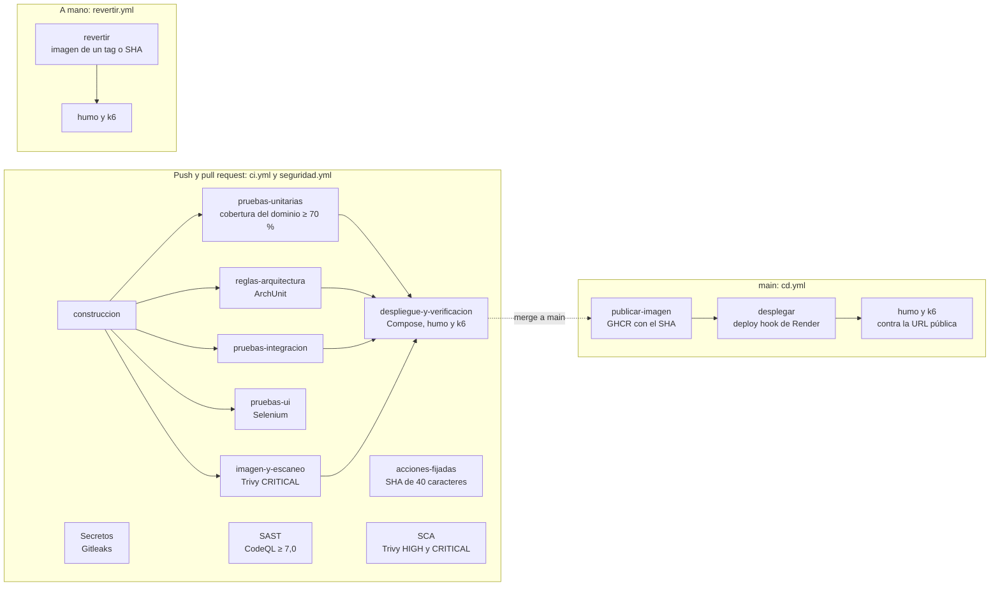

# DevOps de Pet Finder: pipeline, umbrales y reversión

Cómo llega un cambio desde un pull request hasta producción, qué revisa cada etapa, qué la detiene y por qué ese límite, y cómo se vuelve a una versión anterior. Los umbrales de este documento son los mismos de los workflows: **si alguien cambia uno, cambia los dos**.

Workflows (todos en `.github/workflows/`):

| Workflow | Archivo | Cuándo corre |
|---|---|---|
| CI | `ci.yml` | Cada push a cualquier rama, cada tag `v*`, cada pull request a `main`, una vez al día y a mano |
| Seguridad | `seguridad.yml` | Igual que CI |
| CD | `cd.yml` | Cada push a `main` (o sea, cada merge) y cada tag `v*`; también a mano |
| Revertir | `revertir.yml` | Solo a mano, con la versión a la que se quiere volver |
| Carga larga | `carga-larga.yml` | Solo a mano: la prueba de carga completa del Corte 2 (`perf/scripts/carga.js`) contra Compose en el runner |

## 1. Diagrama del pipeline



`despliegue-y-verificacion` es un despliegue efímero dentro del PR: la imagen recién escaneada corre con PostgreSQL en Compose dentro del runner y se borra al terminar. El despliegue real, a Render, lo hace `cd.yml` después del merge.

## 2. Etapas, checks y umbrales

Un check en rojo detiene el pull request: `main` exige que pasen los obligatorios antes de integrar (ruleset de `main`, tarea S2). Los obligatorios hoy son `construccion`, `pruebas-unitarias`, `reglas-arquitectura`, `pruebas-integracion`, `Secretos`, `SAST (java-kotlin)` y `SAST (javascript-typescript)`; `SCA`, `imagen-y-escaneo`, `despliegue-y-verificacion` y `acciones-fijadas` pasan a obligatorios cuando llevan corridas en verde en `main`, y `pruebas-ui` después de tres corridas seguidas en verde en Actions (A11).

| Etapa del enunciado | Check | Workflow y job | Herramienta | Qué lo detiene | Por qué ese umbral | Artefacto |
|---|---|---|---|---|---|---|
| Construcción | `construccion` | `ci.yml` · `construccion` | Maven 3.9.16 (wrapper), JDK 17 Temurin | Que no compile o no empaquete | Nada sigue si el código no compila | — |
| Pruebas unitarias y cobertura | `pruebas-unitarias` | `ci.yml` · `pruebas-unitarias` | JUnit 5, Mockito, JaCoCo 0.8.15 | Una prueba `*Test` en rojo, o menos de **70 % de líneas** cubiertas en `petfinder/domain` | 70 % es lo que pide la rúbrica. Se mide sobre todo el dominio (`BUNDLE`) y no por paquete: con solo unitarias, `domain.observer` queda en 33 % aunque el dominio completo esté en 97 % | `reportes-pruebas-unitarias` (Surefire y el sitio de JaCoCo) |
| Arquitectura verificada | `reglas-arquitectura` | `ci.yml` · `reglas-arquitectura` | ArchUnit | Cualquier dependencia que rompa la arquitectura hexagonal | Cero violaciones: cada regla es una frontera de ADR-001; no hay "un poco" de dependencia prohibida | `reportes-reglas-arquitectura` |
| Pruebas de integración y sistema | `pruebas-integracion` | `ci.yml` · `pruebas-integracion` | Failsafe, Spring Boot Test, H2 con Flyway | Una prueba `*IT` en rojo | Cero fallas: prueban la app arrancada por HTTP y la base real con migraciones | `reportes-pruebas-integracion` |
| Pruebas de interfaz | `pruebas-ui` | `ci.yml` · `pruebas-ui` | Selenium con Chrome sin ventana | Una prueba `*UIT` en rojo | Cero fallas. Todavía no es obligatoria: primero tres corridas seguidas en verde en Linux | `reportes-pruebas-ui` |
| Secretos | `Secretos` | `seguridad.yml` · `secretos` | Gitleaks 8.30.1 (binario con SHA-256 validado), sobre todo el historial | **Cero** secretos | Un secreto en el historial ya es público aunque se borre después; no hay cantidad aceptable | `reporte-secretos` (SARIF) |
| SAST | `SAST (java-kotlin)` y `SAST (javascript-typescript)` | `seguridad.yml` · `sast` | CodeQL (`security-extended`) más `scripts/umbral-sarif.py` | Un hallazgo con `security-severity` de **7,0 o más** que no esté en `.github/codeql/excepciones.txt` | 7,0 es el inicio de "alto" en CVSS: lo alto y lo crítico se corrigen o se justifican una por una; lo medio queda en el reporte | `sarif-java-kotlin`, `sarif-javascript-typescript` y la pestaña Security |
| SCA (dependencias) | `SCA` | `seguridad.yml` · `sca` | Trivy 0.76.1 sobre `pom.xml`, en modo offline con la caché de Maven | Una vulnerabilidad **HIGH o CRITICAL con corrección disponible** | Si existe la versión corregida, subirla es barato; las que no tienen corrección no se pueden arreglar subiendo versión y quedan en el reporte | `reporte-sca` |
| Imagen y escaneo | `imagen-y-escaneo` | `ci.yml` · `imagen-y-escaneo` | Docker Buildx (caché `type=gha`) y Trivy 0.76.1 | Una vulnerabilidad **CRITICAL con corrección** en la imagen, o que el jar traiga `static/js/config-local.js` | En la imagen, solo CRITICAL detiene: los HIGH de la imagen base del sistema operativo suelen no tener parche al día y frenarían todo; quedan en el reporte (ADR-003). El archivo de configuración nunca va en la imagen porque la imagen es pública (amenaza T11) | `reporte-imagen` |
| Despliegue y verificación (efímero) | `despliegue-y-verificacion` | `ci.yml` · `despliegue-y-verificacion` | Docker Compose con PostgreSQL 18, `scripts/humo-flujo.sh`, k6 2.2.0 con `perf/scripts/corta.js` | Que Compose no quede sano, una falla de la prueba de humo, o que no se cumpla el SLO: **p95 menor a 500 ms**, **errores menores a 1 %**, **al menos 1800 peticiones** en 60 s y ninguna iteración perdida | Es el SLO del Corte 2: 30 peticiones por segundo con p95 bajo medio segundo es lo que necesita la app en una noche de búsqueda activa | `reportes-despliegue-y-verificacion` (`humo-flujo.txt`, `k6-resumen.json`, `compose.log`) |
| Cadena de suministro | `acciones-fijadas` | `ci.yml` · `acciones-fijadas` (entra con A8) | `grep` sobre los workflows | Una acción externa referenciada por tag o rama en vez de un **SHA de 40 caracteres** | Un tag se puede mover por debajo; un SHA no. Trivy tuvo el aviso GHSA-69fq-xp46-6x23 (crítico, marzo de 2026) | — |
| Despliegue | `Publicar imagen` | `cd.yml` · `publicar-imagen` | Docker Buildx, GHCR | Que la imagen no se construya, no se publique o no arranque diciendo su propio SHA en `/actuator/info` | Se despliega exactamente lo que se probó, nunca `latest` | — |
| Despliegue | `Desplegar en Render y verificar` | `cd.yml` · `desplegar` | Deploy hook de Render, `humo-flujo.sh`, k6 con `corta.js` | Que Render no llegue a mostrar el SHA nuevo, que falle la prueba de humo o que no se cumplan los mismos umbrales de arriba contra la URL pública, a 6 peticiones por segundo durante 330 s | La latencia y los errores del SLO, ahora en la plataforma real. La capacidad de 30 req/s ya la exigió `despliegue-y-verificacion`: Render gratis no la alcanza (ADR-004, revisión del 2026-11-16) | `carga-corta` (`carga-corta.json`) |

Todo el pipeline usa `permissions: contents: read` arriba de cada workflow; los permisos extra van solo en el job que los necesita (`security-events: write` en `sast`, `packages: write` en `publicar-imagen`). El único secreto propio, `RENDER_DEPLOY_HOOK_URL`, vive en el entorno `produccion` de GitHub y solo lo leen `desplegar` y `revertir`.

## 3. Caché y tiempo

- **Maven:** `actions/setup-java` con `cache: maven` guarda `~/.m2` entre corridas, con la llave del `pom.xml`.
- **Docker:** `imagen-y-escaneo` construye con la caché `type=gha`. El `Dockerfile` copia primero solo el `pom.xml` y descarga las dependencias en una capa propia, así que mientras el pom no cambie esa capa no se vuelve a descargar. Por eso no usa `--mount=type=cache`, que vive solo en la máquina que construye y no viaja en la caché de Actions (A3).
- **Paralelo:** después de `construccion`, las cuatro etapas de pruebas y la imagen corren al mismo tiempo, y Seguridad corre en paralelo con CI.

**Tiempo medido** en el merge del PR #74 (A6) a `main` (2026-11-16), con el pipeline completo: CI y Seguridad en paralelo, desde que arrancó el primer job hasta que terminó el último que cuenta la rúbrica (todo menos el despliegue y la carga):

| Tramo | Desde | Hasta | Duración |
|---|---|---|---|
| Integración: construcción, pruebas, arquitectura, imagen y escaneo, y los tres controles de Seguridad | 23:58:12 UTC | 00:01:07 UTC (`imagen-y-escaneo`, el más lento; le sigue `SAST (java-kotlin)` a las 00:00:41) | **2 min 55 s** |
| Con `despliegue-y-verificacion` (Compose, humo y k6), que la rúbrica no cuenta | 23:58:12 UTC | 00:04:36 UTC | 6 min 24 s |

Los dos quedan por debajo de los 10 minutos. Las tres corridas de ese commit terminaron en verde:
- CI: https://github.com/DrearSanti/pet-finder-dyas/actions/runs/43983740657
- Seguridad: https://github.com/DrearSanti/pet-finder-dyas/actions/runs/43983740661
- CD: https://github.com/DrearSanti/pet-finder-dyas/actions/runs/43983740834

Antes de A6 (merge del PR #54, 2026-11-15) la integración tardaba 2 min 5 s; los 50 s de diferencia son la construcción y el escaneo de la imagen.

## 4. Corrida diaria

CI y Seguridad corren solos todos los días a las **11:00 UTC (6:00 en Bogotá)** sobre `main` (`schedule: cron '0 11 * * *'`). La base de vulnerabilidades de Trivy cambia todos los días sin que nadie toque el código: con la corrida diaria, una vulnerabilidad nueva en una dependencia o en la imagen base aparece como un check en rojo en `main` antes de que llegue el siguiente PR, y no el día de la entrega. Se arregla subiendo la versión corregida en un PR; nunca bajando el umbral.

Dependabot (`.github/dependabot.yml`) abre cada semana PR con versiones nuevas de las dependencias de Maven, la imagen base del `Dockerfile` y las acciones (sube el SHA y el comentario de versión). Pasan por el mismo pipeline y la misma revisión que cualquier otro PR.

## 5. Versionado

- Cada commit de `main` produce la imagen `ghcr.io/drearsanti/pet-finder:<SHA completo>`.
- Una versión se marca con un tag anotado `vX.Y.Z` sobre `main`; el mismo `cd.yml` publica además `ghcr.io/drearsanti/pet-finder:vX.Y.Z`:
  ```bash
  git switch main && git pull
  git tag -a v3.0.0 -m "v3.0.0: Corte 3"
  git push origin v3.0.0
  ```
- **Nunca se usa `latest`**: cada despliegue y cada reversión nombran exactamente qué código corre.
- `/actuator/info` responde el commit y la versión de lo que está corriendo (`PETFINDER_COMMIT` y `PETFINDER_VERSION`, que el pipeline le pasa a la imagen al construirla).
- Los cambios de cada versión van en `CHANGELOG.md`.

## 6. Despliegue

Lo hace `cd.yml` en cada merge a `main` (decisión y alternativas en [ADR-004](adr/ADR-004-estrategia-de-despliegue.md); vista de despliegue en [arquitectura.md, sección 8](arquitectura.md#8-vista-de-despliegue-corte-3)):

1. **`publicar-imagen`** construye con el `Dockerfile`, publica `ghcr.io/drearsanti/pet-finder:<SHA>` (y `:<versión>` si es un tag), arranca la imagen publicada y comprueba que `/actuator/info` diga ese SHA.
2. **`desplegar`**, dentro del entorno `produccion`, llama al deploy hook de Render (`RENDER_DEPLOY_HOOK_URL`) con la imagen de ese commit y espera hasta que `https://pet-finder-akac.onrender.com/actuator/info` muestre el SHA nuevo: mientras Render cambia de versión, la anterior sigue respondiendo sana, así que probar antes daría un falso verde.
3. Después corre `scripts/humo-flujo.sh` y `perf/scripts/corta.js` contra la URL pública. Si no se cumple el SLO, el despliegue queda en rojo.

Un despliegue a la vez: `cd.yml` y `revertir.yml` comparten el grupo de concurrencia `despliegue-produccion`, así que una reversión nunca se cruza con un despliegue.

**Estado al 2026-11-15:** el despliegue y la prueba de humo pasan, pero la carga corta contra Render falla en el plan gratis (p95 de unos 10 s y 29 % de errores; la misma imagen en Compose da p95 de 11 ms y 0 % de errores). Ejemplo: https://github.com/DrearSanti/pet-finder-dyas/actions/runs/43773648786. Falló tres de tres, todas por capacidad: en la última, Render gratis alcanzó unas 16 req/s, sin errores pero con p95 de 9,55 s.

**Decisión del 2026-11-16 (revisión de ADR-004):** el servicio se queda en el plan gratis. La capacidad de 30 req/s se exige en cada PR con `despliegue-y-verificacion`, y el CD mide contra Render los mismos umbrales a 6 req/s durante 330 s (`ITERACIONES_POR_SEGUNDO=2` y `MEDICION=330s` en `cd.yml` y `revertir.yml`). Primera corrida de CD en verde con esta tasa, el 2026-11-16 sobre el merge del #81: https://github.com/DrearSanti/pet-finder-dyas/actions/runs/43977291762. Contra Render gratis dio p95 de 198 ms (entre 143 y 195 ms por operación), 0 % de errores en 2073 peticiones, 1983 peticiones medidas (mínimo 1800) y 0 iteraciones perdidas.

## 7. Reversión

Se vuelve a una versión que ya está publicada en GHCR, sin reconstruir nada:

1. GitHub → **Actions** → **Revertir** → **Run workflow** → en `version`, el tag (`v3.0.0`) o el SHA completo de 40 caracteres de un commit de `main`. Desde la terminal:
   ```bash
   gh workflow run revertir.yml -f version=v3.0.0
   gh run watch
   ```
2. Qué hace y qué comprueba `revertir.yml`:
   - Resuelve el commit del tag o valida el SHA, y comprueba con `docker manifest inspect` que la imagen `ghcr.io/drearsanti/pet-finder:<versión>` exista. Las versiones anteriores al pipeline (v1.0.0, v2.0.0) no tienen imagen y se rechazan.
   - Le pide a Render esa imagen con el mismo deploy hook.
   - Espera a que `/actuator/info` muestre el commit de esa versión.
   - Corre la prueba de humo y la carga corta, igual que el CD. Si fallan, la reversión queda en rojo.
3. Después de revertir, arregla el problema con un PR normal: el siguiente merge a `main` despliega la versión corregida.

Para revertir también el código (no solo lo desplegado): `git revert <sha-del-merge> -m 1` en una rama y un PR, que al integrarse se despliega solo.

**Primera ejecución real (2026-11-16), en rojo, y lo que se corrigió:** https://github.com/DrearSanti/pet-finder-dyas/actions/runs/43983664571. La reversión a `v2.1.0` funcionó: Render pasó a correr `a2b8887` y la prueba de humo pasó. Pero la carga corta falló (p95 de 1,3 s), porque en medio entró el merge del #74 y su CD desplegó mientras Revertir medía: `cd.yml` usaba su propio grupo de concurrencia (`cd-<rama>`) y no `despliegue-produccion`, así que la promesa de "un despliegue a la vez" solo la cumplía `revertir.yml`. Se corrigió poniendo el job `desplegar` de `cd.yml` en el grupo `despliegue-produccion`.

**Ejecución en verde (2026-11-16, ya con la corrección):** https://github.com/DrearSanti/pet-finder-dyas/actions/runs/43994285937. Revirtió a `v2.1.0`: `/actuator/info` pasó a mostrar el commit `a2b8887` con `"version":"v2.1.0"`, la prueba de humo pasó y la carga corta dio p95 de 178 ms, 0 % de errores, 1983 peticiones medidas y 0 iteraciones perdidas. Después, el siguiente merge a `main` volvió a desplegar la versión actual.

## 8. Pruebas en rojo

Cada control se probó en rojo en una rama desechable que nunca se integró y se borró después. Las corridas siguen en Actions.

| Control | Rama desechable | Qué se cambió | Resultado esperado | Enlace |
|---|---|---|---|---|
| Cobertura | `prueba/umbral-099` | `<minimum>0.99</minimum>` en `pom.xml` | `pruebas-unitarias` en rojo: `Rule violated for bundle pet-finder-dyas: lines covered ratio is 0.85, but expected minimum is 0.99` (0,85 con solo unitarias; 0,97 con unitarias e IT) | https://github.com/DrearSanti/pet-finder-dyas/actions/runs/43799941551 |
| SCA | `prueba/sca-rojo` | `org.apache.commons:commons-text:1.9` (CVE-2022-42889, crítica) en `pom.xml` | `SCA` en rojo: `Total: 1 (HIGH: 0, CRITICAL: 1)`, `org.apache.commons:commons-text` CVE-2022-42889, corregida en 1.10.0 | https://github.com/DrearSanti/pet-finder-dyas/actions/runs/43800039341 |
| Imagen | `prueba/imagen-rojo` | La misma dependencia | `imagen-y-escaneo` en rojo en el paso de Trivy: CVE-2022-42889 dentro de `app.jar` (`Total: 1 (CRITICAL: 1)`) | https://github.com/DrearSanti/pet-finder-dyas/actions/runs/43800064151 |
| Configuración en la imagen | `prueba/config-local` | `config-local.js` forzado dentro del jar | `imagen-y-escaneo` en rojo en el paso "El jar de la imagen no trae config-local.js": `La imagen trae static/js/config-local.js; la clave de CARTO va en PETFINDER_CLAVE_CARTO.` | https://github.com/DrearSanti/pet-finder-dyas/actions/runs/43800109671 |
| Acciones fijadas | `prueba/acciones-fijadas` | `uses: actions/checkout@v5` (por tag) en `carga-larga.yml` | `acciones-fijadas` en rojo: `Acciones sin SHA de 40 caracteres: .github/workflows/carga-larga.yml:24: uses: actions/checkout@v5` | https://github.com/DrearSanti/pet-finder-dyas/actions/runs/43801069079 |
| SAST | `prueba/sast` (PR #42, cerrado sin integrar) | Un controlador vulnerable a propósito | `SAST (java-kotlin)` en rojo | https://github.com/DrearSanti/pet-finder-dyas/actions/runs/43050165768 |
